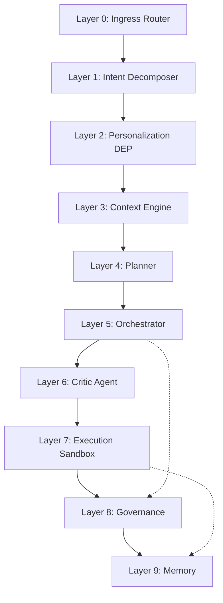

# SELENE OS Architecture Overview

## Executive Summary
SELENE OS is a cutting-edge multi-agent cognitive operating system designed to bridge the gap between complex software systems and human-like problem-solving capabilities. Built on a modular 10-layer architecture, SELENE OS integrates advanced language models, a specialized memory architecture, and robust governance mechanisms to execute complex, multi-step tasks safely and effectively. 

This document serves as the top-level architectural blueprint of SELENE OS, detailing its layers, data flow, inter-layer communication, design principles, and core technology choices.

## High-Level Architecture Diagram

## Layer Breakdown

### Layer 0 - Ingress Router
The entry point for all incoming requests. 
- **Implementation**: FastAPI endpoints and WebSockets.
- **Features**: Rate limiting, authentication, payload validation, and request tracing.
- **Purpose**: Ensures that only valid, authenticated requests enter the cognitive runtime.

### Layer 1 - Intent Decomposer
Analyzes raw user input to determine the core intent and decompose complex requests.
- **Implementation**: LLM-based intent classification (e.g., query, command, chit-chat).
- **Features**: Task decomposition into atomic actions.
- **Purpose**: Converts ambiguous human language into structured, actionable intents for the system.

### Layer 2 - Personalization (DEP)
Dynamic Embedding Profiles (DEP) tailor the system's responses and actions to individual users.
- **Implementation**: Sparse Autoencoder filtering and Cosine-delta personalization.
- **Features**: Adapts behavior if `cos(DEP_current, DEP_new) < 0.85`.
- **Purpose**: Maintains a persistent understanding of user preferences, coding style, and typical workflows.

### Layer 3 - Context Engine
Retrieves relevant information to ground the LLM's understanding of the task.
- **Implementation**: RRF 70/30 hybrid search with BM25 + FAISS + BGE-2 reranking.
- **Features**: High-accuracy semantic and lexical search fusion.
- **Purpose**: Injects necessary workspace context, historical memories, and documentation into the prompt.

### Layer 4 - Planner
Constructs a deterministic sequence of steps to fulfill the intent.
- **Implementation**: Multi-step plan generation with capability-tool matching.
- **Features**: Dependency graph generation, fallback strategies.
- **Purpose**: Creates an actionable roadmap before execution begins, ensuring logical flow.

### Layer 5 - Orchestrator
The central brain that coordinates the execution of the plan.
- **Implementation**: LangGraph state machine with 10 cognitive nodes.
- **Features**: State management, routing, and node execution.
- **Purpose**: Manages the lifecycle of a request, transitioning between planning, execution, and review.

### Layer 6 - Critic Agent
Statistically validates the proposed plan and execution results.
- **Implementation**: Shannon entropy, perplexity, and JS divergence scoring.
- **Features**: Rejects plans with high perplexity (uncertainty) or entropy.
- **Purpose**: Acts as an internal quality control mechanism, ensuring high-confidence outputs.

### Layer 7 - Execution Sandbox
Safely runs code, commands, and tools.
- **Implementation**: E2B microVM + local subprocess fallback.
- **Features**: 30-second timeout, strict resource limits.
- **Purpose**: Isolates execution from the core OS to prevent catastrophic failures or security breaches.

### Layer 8 - Governance
Enforces safety and human-in-the-loop (HITL) policies.
- **Implementation**: HITL mutation locks, SSRF protection, shell/code blocking.
- **Features**: Operator covenant principles, regex-based command blocking.
- **Purpose**: Prevents the system from taking destructive actions without explicit human approval.

### Layer 9 - Memory
A persistent storage layer for short and long-term retention.
- **Implementation**: 5-layer stratification with exponential temporal decay.
- **Features**: Working, episodic, semantic, procedural, and archival stores.
- **Purpose**: Allows SELENE to learn from past interactions, avoid repeating mistakes, and recall complex procedures.

## Data Flow Explanation
1. A user sends a message via the Next.js frontend to the Layer 0 FastAPI ingress.
2. Layer 1 decomposes the intent and Layer 2 applies personalization context.
3. Layer 3 fetches relevant memory and workspace context.
4. Layer 4 formulates a plan, passing it to Layer 5 (Orchestrator).
5. The Orchestrator routes the plan to Layer 6 (Critic) for validation.
6. Once validated, the plan is executed in Layer 7 (Sandbox).
7. Layer 8 (Governance) monitors execution for policy violations.
8. Results are fed back into Layer 9 (Memory) for future context.
9. Final response is routed back to the user.

## Inter-layer Communication Patterns
- **Synchronous HTTP/REST**: Used for external API calls and Layer 0 ingress.
- **State Dictionary (LangGraph)**: The `SeleneState` object is passed between nodes in the Orchestrator, ensuring immutable state transitions.
- **Asynchronous Message Queues**: Used for background memory summarization and long-running execution tasks.

## Design Principles
1. **Separation of Concerns**: Each layer has a single, well-defined responsibility.
2. **Fail-Safe Defaults**: Execution falls back to safe states (e.g., local subprocess with timeouts) if primary systems (like E2B) fail.
3. **Defense in Depth**: Governance checks are layered across network ingress (L0), planning (L4/L6), and execution (L8).
4. **Observable State**: LangGraph's explicit state machine makes debugging and tracing execution paths trivial.

## Technology Choices & Rationale
- **FastAPI**: Chosen for its high performance and native async support.
- **LangGraph**: Enables complex, cyclic agent workflows that standard linear chains cannot support.
- **FAISS + BM25**: Provides the best of both worlds—dense embeddings for semantic understanding and sparse vectors for exact keyword matching.
- **E2B MicroVMs**: Offers secure, fast-booting isolation for untrusted code execution.
