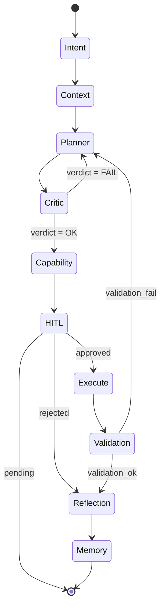

# Cognitive Runtime (LangGraph)

## Overview
The Cognitive Runtime in SELENE OS is powered by a LangGraph state machine. It acts as the central orchestration layer (Layer 5), managing the lifecycle of a request from intent parsing to execution and memory consolidation. By utilizing a cyclic graph, SELENE can iteratively plan, execute, critique, and refine its actions.

## LangGraph State Machine
LangGraph models agent execution as a state graph. Each node represents a cognitive function (e.g., Planning, Execution), and edges define the conditional routing logic between them. The state is passed from node to node, being updated at each step.

## SeleneState TypedDict Schema
The entire state of a cognitive loop is encapsulated in `SeleneState`.
```python
from typing import TypedDict, List, Dict, Any, Optional

class SeleneState(TypedDict):
    user_id: str
    session_id: str
    raw_input: str
    intents: List[str]
    selected_mode: str
    context_bundle: Dict[str, Any]
    plan: List[Dict[str, Any]]
    critic_verdict: str
    capability_result: Any
    execution_result: Dict[str, Any]
    validation_ok: bool
    hitl_status: str  # pending, approved, rejected
    reflection_notes: str
    memory_ops: List[Dict[str, Any]]
    final_response: str
    error: Optional[str]
    turn_count: int
```

## The 10 Cognitive Nodes
1. **intent**: (Layer 1) Classifies `raw_input` into structured `intents`.
2. **context**: (Layer 3) Uses `intents` to fetch relevant data into `context_bundle`.
3. **planner**: (Layer 4) Generates a multi-step `plan` based on context.
4. **critic**: (Layer 6) Validates the `plan` statistically. Updates `critic_verdict`.
5. **capability**: Maps plan steps to available tools and APIs.
6. **execute**: (Layer 7) Runs the tool/code in the sandbox. Updates `execution_result`.
7. **validation**: Validates the `execution_result`. Updates `validation_ok`.
8. **hitl**: (Layer 8) Human-in-the-loop check. Pauses execution if `hitl_status` is pending.
9. **reflection**: Analyzes outcomes and generates `reflection_notes`.
10. **memory**: (Layer 9) Consolidates `reflection_notes` and state into `memory_ops`.

## Node Routing Logic
Routing is handled via conditional edges. A primary example is the HITL routing:
- If `hitl_status == "pending"`, edge routes to `__end__` (pausing execution).
- If `hitl_status == "approved"`, edge routes to `execute`.
- If `hitl_status == "rejected"`, edge routes to `reflection` to learn why it was rejected.

Other critical routings:
- `critic` -> `planner` if `critic_verdict` fails validation.
- `validation` -> `planner` (re-plan) if `validation_ok` is False.

## Graph Compilation and Invocation
The graph is compiled once at startup in `backend/core/graph_routing.py`:
```python
workflow = StateGraph(SeleneState)
# Add nodes...
workflow.add_node("planner", plan_node)
# Add edges...
workflow.add_conditional_edges("hitl", hitl_router)
# Compile
app = workflow.compile(checkpointer=MemorySaver())
```
Invocation is done via `app.invoke(initial_state)`.

## Error Handling
Errors are caught within node execution blocks. If an unrecoverable error occurs, the `error` field in `SeleneState` is populated, and a conditional edge routes directly to the `reflection` and `memory` nodes to log the failure, followed by returning a safe error message to the user.

## State Diagram

