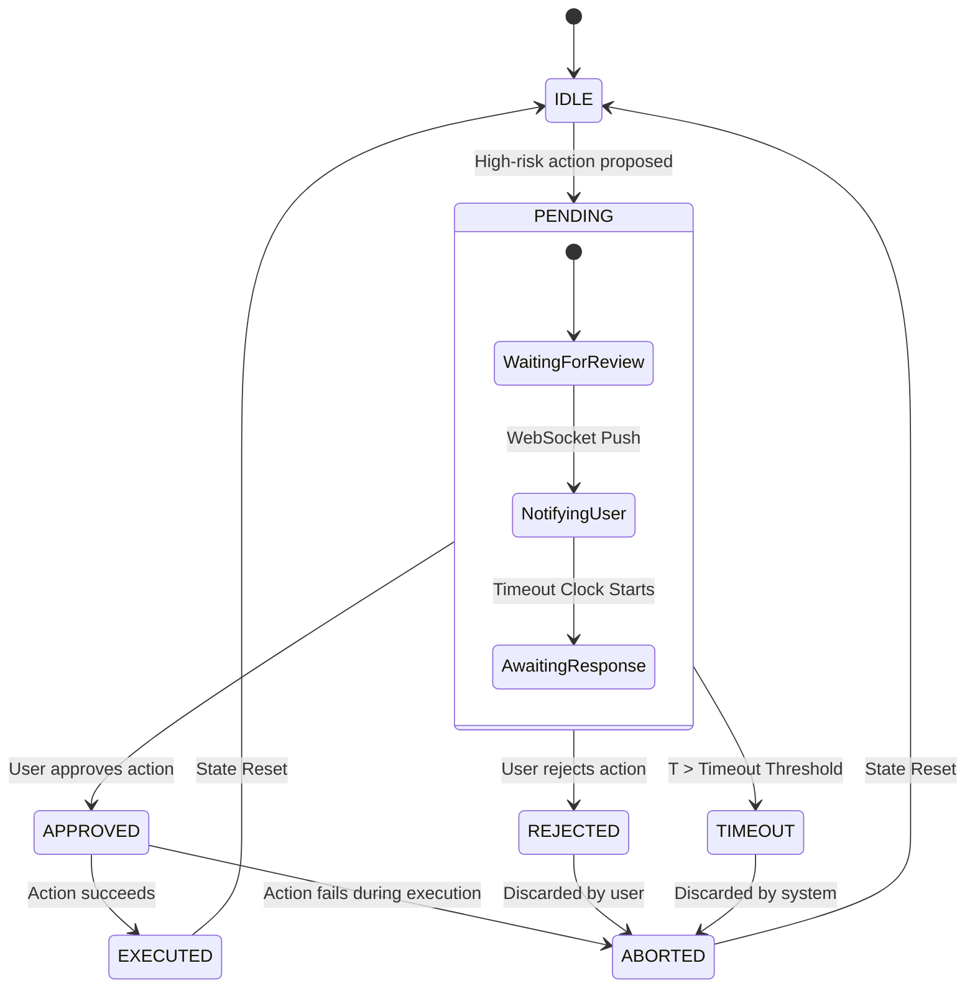

# Human-in-the-Loop (HITL) State Machine Documentation

The Human-in-the-Loop (HITL) system in SELENE OS is a critical governance component located in Layer 8. It ensures that sensitive operations, structural mutations, or high-risk execution paths are paused for human review before proceeding. 

This document details the HITL state machine, its integration with the LangGraph orchestrator, the mutation lock mechanism, timeout handling, and practical code references.

## 1. Overview and Rationale

In a fully autonomous multi-agent system, the boundary between automated execution and human oversight is delicate. SELENE OS employs a rigid state machine for its HITL controls. When an agent (typically the planner or capability node) suggests an action that exceeds pre-defined safety thresholds or matches an explicit HITL rule, the system suspends the execution graph and transitions into a `PENDING` state.

This mechanism is primarily implemented in `backend/governance/hitl.py` and is represented globally in the LangGraph state via the `hitl_status` field of the `SeleneState` TypedDict.

## 2. HITL State Diagram

The lifecycle of a HITL request follows a deterministic state machine.



## 3. State Definitions and Transitions

### States
- **IDLE**: The default state of the orchestrator. No pending HITL requests exist. Standard cognitive nodes run without interruption.
- **PENDING**: The graph execution is paused. A high-risk action has been placed in the review queue. The system awaits external input.
- **APPROVED**: The human operator has explicitly granted permission for the action to proceed. The mutation lock is lifted for this specific action.
- **REJECTED**: The human operator has explicitly denied permission. The action is discarded.
- **EXECUTED**: The approved action has been successfully run by the execution sandbox (Layer 7).
- **ABORTED**: The action was either rejected, timed out, or failed during execution, leading to a rollback or continuation of the graph without the action.
- **TIMEOUT**: The human operator did not respond within the configured time window.

### Transitions & Triggers
1. **IDLE → PENDING**: Triggered by the `governance` node when a capability matches a regex or semantic rule in `backend/governance/safety.py` (e.g., shell commands, deployment mutations, file deletion).
2. **PENDING → APPROVED**: Triggered via a `POST /api/hitl/approve/{task_id}` REST call from the Next.js frontend or CLI.
3. **PENDING → REJECTED**: Triggered via a `POST /api/hitl/reject/{task_id}` REST call.
4. **PENDING → TIMEOUT**: Triggered by an internal background worker traversing the pending requests and comparing `created_at` + `timeout_ms` < `current_time`.

## 4. Mutation Lock Mechanism

One of the most critical aspects of the HITL system is the **Mutation Lock**. 
When the system enters the `PENDING` state, a global or workspace-scoped lock is placed on the state. 

### Why is this necessary?
If a user is reviewing a destructive action (e.g., `rm -rf /var/log`), the underlying system state must not change. If the orchestrator continued to plan or execute other tasks, the context in which the human makes their decision could be invalidated.

### Implementation Details
The mutation lock sets a flag in Redis: `selene:mutation_lock:{workspace_id}`.
While this lock is active:
- No new `PENDING` requests can be created for that workspace.
- Background agents cannot write to the working memory layer.
- The `hitl_status` in `SeleneState` is marked as `LOCKED`.

This ensures structural consistency. Once the state transitions to `APPROVED`, `REJECTED`, or `TIMEOUT`, the lock is released.

## 5. LangGraph Node Routing Integration

The HITL state is intrinsically tied to the LangGraph orchestrator in Layer 5. The orchestrator uses conditional edges based on the `hitl_status` field.

```python
# Reference: backend/core/graph_routing.py

def route_from_governance(state: SeleneState):
    if state["hitl_status"] == "PENDING":
        return "hitl_node"  # Pauses execution, yields to user
    elif state["hitl_status"] == "APPROVED":
        return "execution_sandbox"
    else:
        return "critic_agent"
```

When execution yields at the `hitl_node`, the state is serialized to PostgreSQL, allowing the FastAPI server to handle the asynchronous user response via REST/WebSocket, and then resume the graph execution from the persisted state checkpoint.

## 6. Timeout Handling

To prevent the system from deadlocking on a pending human response, the `HITLManager` implements a strict timeout policy.

The timeout threshold is configurable but defaults to **300 seconds (5 minutes)**.

```python
# Reference: backend/governance/hitl.py

async def check_timeouts():
    now = datetime.utcnow()
    pending_requests = await db.get_pending_hitl_requests()
    for req in pending_requests:
        if (now - req.created_at).total_seconds() > req.timeout_seconds:
            await transition_state(req.id, "TIMEOUT")
            await release_mutation_lock(req.workspace_id)
            # Notify user via WebSocket of timeout
            await ws_manager.broadcast(req.workspace_id, {"type": "HITL_TIMEOUT", "id": req.id})
```

If a timeout occurs, the LangGraph state is updated, and the graph routes to a fallback or reflection node, informing the LLM that the proposed action was aborted due to human non-response.

## 7. Examples of HITL-Gated Operations

By default, SELENE OS intercepts the following operations:

1. **System Shell Access**: Any generic `bash` or `powershell` capability execution.
2. **File Deletion**: Destructive file operations (`rm`, `del`).
3. **Network Configuration**: Modifications to system firewall or network interfaces.
4. **Outbound Data Exfiltration**: HTTP POST/PUT requests to unknown domains (SSRF protection).
5. **Database Schema Mutations**: `DROP TABLE`, `ALTER TABLE` operations.

Users can define custom HITL rules in their `selene.toml` configuration, which the `governance` node will parse and enforce.

## 8. Code References

- `backend/governance/hitl.py`: Contains the `HITLManager` class, state transition logic, and timeout background workers.
- `backend/governance/safety.py`: Evaluates intents and capabilities to determine if HITL is required.
- `backend/core/graph_state.py`: Defines the `SeleneState` TypedDict, including `hitl_status`.
- `backend/core/graph_routing.py`: LangGraph conditional edges that pause and resume the graph based on HITL approval.
- `backend/main.py`: Exposes the FastAPI REST endpoints for `/api/hitl/approve` and `/api/hitl/reject`.
