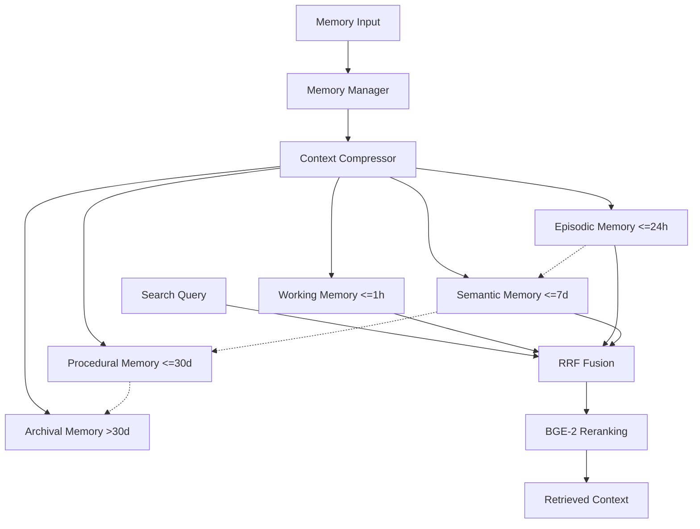

# Memory Architecture

## Overview
SELENE OS employs a biologically inspired 5-layer stratified memory system. This architecture ensures that the agent can retain context over varying temporal windows, from immediate working memory to lifelong archival storage. It utilizes a hybrid search pipeline and exponential temporal decay to surface the most relevant information efficiently.

## Architecture Diagram

## 5 Stratification Layers
1. **Working Memory (≤1hr)**: High-speed, immediate context. Stores the current conversation loop and exact state variables.
2. **Episodic Memory (≤24hr)**: Specific events and actions taken during the day. "I ran `npm install` 2 hours ago."
3. **Semantic Memory (≤7d)**: Generalized facts and user preferences learned over the week. "The user prefers Python over JavaScript."
4. **Procedural Memory (≤30d)**: How-to guides, successful plans, and tool usage patterns.
5. **Archival Memory (>30d)**: Long-term storage of project structures, architectural decisions, and major milestones.

## Exponential Temporal Decay
Memory relevance decays over time using the formula:
`Score_final = Score_initial × exp(-λ·Δt_hours)`
- `λ = 0.01` (default decay rate)
- `Δt_hours` = Hours since the memory was formed.
This ensures that recent episodic memories are prioritized over older ones unless the older memory has a vastly superior initial semantic match.

## Hybrid Search Pipeline
Retrieval relies on a multi-stage fusion approach:
1. **Sparse Search (BM25)**: TF-IDF based keyword matching. Excellent for specific variable names or exact error codes.
2. **Dense Search (FAISS)**: Semantic embedding search. Excellent for conceptual matches.
3. **RRF Fusion**: Reciprocal Rank Fusion combines the results. `Score_RRF = (α * Rank_Dense) + ((1 - α) * Rank_Sparse)`. In SELENE, `α = 0.7` (prioritizing semantic) and `1 - α = 0.3` (sparse).
4. **Reranking**: The top-K fused results are passed through the `BAAI/bge-reranker-base` cross-encoder for final, high-accuracy ordering.

## Memory Stores & Vector Implementation
- **Stores**: `EpisodicStore`, `SemanticStore`, `ProceduralStore`, and `WorkingMemoryStore` all inherit from a base `MemoryStore` interface.
- **FAISS**: Uses `IndexFlatIP` (Inner Product) for cosine similarity on normalized embeddings. Default dimensionality is 384 (e.g., all-MiniLM-L6-v2).
- **BM25**: Implemented using standard Okapi BM25 with TF-IDF scoring.

## Context Compression Pipeline
To prevent context window overflow, retrieved memories pass through a Context Compressor. This uses a lightweight LLM prompt to summarize and extract only the snippets directly relevant to the current `SeleneState.intents`, discarding verbose metadata.
