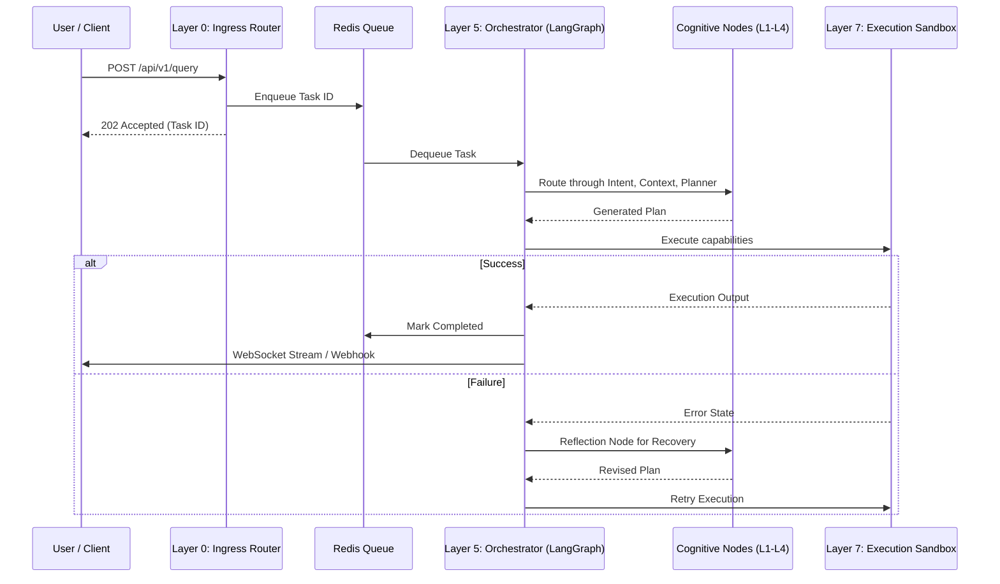

# Query and Task Queue Lifecycle Documentation

The Queue Lifecycle in SELENE OS manages the end-to-end journey of user requests, system triggers, and background tasks. From ingress at Layer 0 to final execution and response, every task moves through a structured, observable pipeline.

## 1. Lifecycle Overview

The system processes tasks asynchronously. When a request arrives via REST or WebSocket, it is placed in an ingestion queue (backed by Redis), processed by the LangGraph orchestrator, and eventually resolved.

### Core Stages
1. **Received (Ingress)**: Request authenticated, rate-limited, and buffered in Redis.
2. **Classified**: Layer 1 Intent Decomposer analyzes the intent.
3. **Contextualized**: Layer 3 Context Engine retrieves relevant memory and state.
4. **Planned**: Layer 4 Planner breaks the request into discrete executable steps.
5. **Validated**: Layer 6 Critic evaluates the plan for viability and constraints.
6. **Executed**: Layer 7 Execution Sandbox runs the code/commands.
7. **Responded**: Final outputs are consolidated and returned to the user.

## 2. Mermaid Sequence Diagram

## 3. Detailed Queue Stages

### 3.1 Received
- **Component**: `backend/main.py`
- **Action**: Endpoints parse incoming JSON. The request is assigned a UUID `task_id`.
- **Storage**: The payload is stored in Postgres (`tasks` table), and the ID is pushed to Redis list `selene:ingress_queue`.

### 3.2 Classified & Planned
- **Component**: `backend/core/orchestrator.py`
- **Action**: A background worker pulls from `selene:ingress_queue` and instantiates the LangGraph runner. The task state transitions to `IN_PROGRESS`.
- **Metrics**: Time spent in queue is logged to Prometheus.

### 3.3 Executed
- **Component**: `backend/governance/plugin_sandbox.py`
- **Action**: Leaf nodes of the plan are executed. Depending on the `hitl_status`, this may block and wait for human review (see HITL documentation).

### 3.4 Responded
- **Component**: `backend/core/orchestrator.py`
- **Action**: Upon graph completion, the final state is serialized. The frontend is notified via WebSocket event `TASK_COMPLETED`. The output is written to memory.

## 4. Error States and Recovery

Tasks do not simply "fail" in SELENE OS. The orchestrator incorporates reflection and self-correction loops.

- **Execution Error**: If a command fails (exit code > 0), the graph routes to the **Reflection Node**. The agent is provided the stderr and asked to formulate a fix.
- **Deadletter Queue**: If a task fails 3 consecutive times in the reflection loop, it is moved to the `selene:deadletter` queue.
- **System Crash**: If the FastAPI process dies midway, unfinished tasks in Postgres marked as `IN_PROGRESS` are picked up by a recovery worker on restart.

## 5. Timeout Policies

To prevent hung agents from consuming resources:
- **Global Task Timeout**: Default 10 minutes. If a task takes longer, it is forcibly terminated.
- **Node Timeout**: Individual LLM API calls are capped at 60 seconds.
- **Execution Timeout**: E2B Sandbox executions are hard-capped at 30 seconds to prevent infinite loops (e.g., `while True`).

## 6. Concurrent Request Handling

SELENE OS uses Python's `asyncio` combined with a worker pool model.
- The FastAPI server can accept thousands of concurrent connections.
- The number of active LangGraph orchestrators is limited by the `MAX_CONCURRENT_TASKS` environment variable (default: 10).
- Tasks beyond this limit remain in the Redis queue, ensuring the system is not overwhelmed and rate limits with OpenAI/Anthropic are respected.
