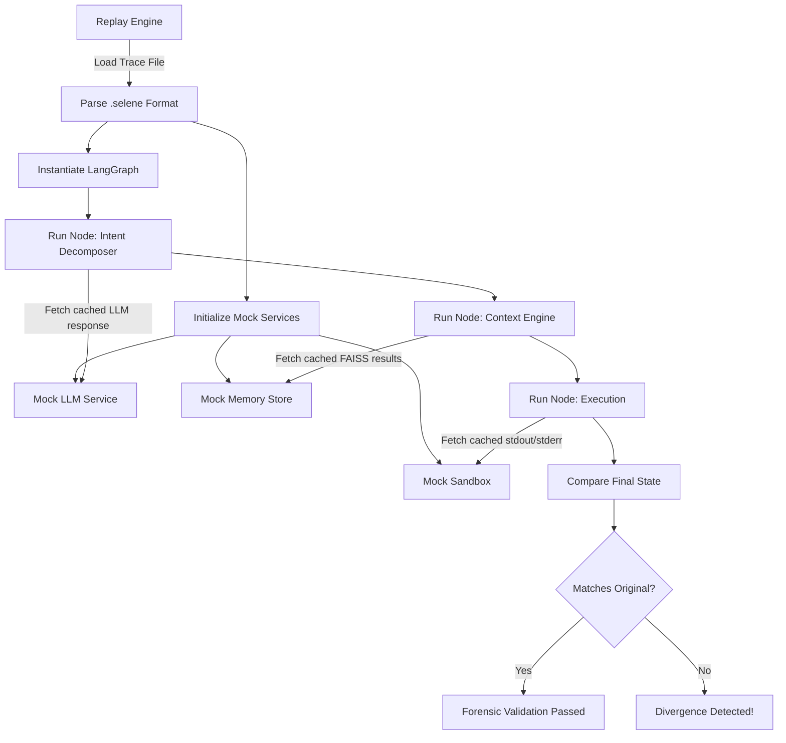

# Replay and Forensics Lifecycle

The Replay System in SELENE OS is a powerful debugging and auditing feature that allows developers and administrators to reconstruct the exact cognitive processes, memory states, and LLM responses of past executions.

## 1. What Replay Means in SELENE

In traditional software, "replay" might mean re-running a script. In an LLM-driven multi-agent system, replay is vastly more complex due to non-determinism (LLM temperature, dynamic memory retrieval). 

In SELENE, Replay means executing the LangGraph state machine using a **cached, deterministic snapshot** of all external interactions (API calls, vector searches, tool executions). This allows developers to step through a past interaction exactly as it happened, or mutate one specific variable (like tweaking the prompt) while keeping everything else constant.

## 2. The Golden Trace Format (.selene)

Traces are serialized into a proprietary binary/JSON hybrid format called `.selene` (e.g., `golden_trace_alpha_v0_1_3.selene`).

A trace file contains:
- **Metadata**: Timestamp, SELENE version, Git commit hash, User ID.
- **Initial State**: The exact user prompt and initial `SeleneState` dictionary.
- **Node Snapshots**: For every LangGraph node visited, an array containing:
  - Input state to the node.
  - External API calls made (and their exact responses).
  - Output state from the node.
- **Memory Snapshot**: A frozen copy of the FAISS indices and BM25 documents retrieved during the session.

## 3. Replay Flow Diagram



## 4. Trace Capture Mechanism

Trace capture is implemented as a middleware/interceptor layer over the LangGraph runtime. 

- **At the node level**: `backend/core/orchestrator.py` wraps every node execution. Before passing the state to the node, it takes a deep copy. After the node returns, it records the delta.
- **At the service level**: The `LLMService` (`backend/services/llm_service.py`) and external connectors check if `TRACE_MODE=RECORD` is active. If so, they append request/response pairs to the current trace buffer.

## 5. Replay Execution (Time Travel)

To replay a trace, the system is started in `TRACE_MODE=REPLAY` and provided a trace file.
1. The orchestrator intercepts all external network calls.
2. When the Planner node asks the LLM for a plan, the `LLMService` intercepts this, looks up the exact prompt in the trace file, and returns the cached response.
3. This creates a purely deterministic environment.

### Mutation Testing
Developers can partially disable the mock for specific nodes. For example, to test a new version of the Planner prompt:
- Replay everything deterministically up to the Planner node.
- Allow the Planner node to make a *live* API call to the LLM.
- Resume deterministic mock execution for the rest of the graph using the new plan.

## 6. Forensic Analysis (Expected vs Actual)

The primary use case for replays is regression testing. Continuous Integration (CI) runs hundreds of `.selene` golden traces against the latest code.

The Critic agent (Layer 6) validates these replays:
- **DAG & Invariant Validation**: Ensures the replayed execution matches the structural dependency graph and capability bounds of the golden trace.
- **Trace Divergence Verification**: Compares the sequence and outputs of executed actions against the golden trace. Any unexpected deviation or missing dependency in CI flags a behavior shift.

## 7. Practical Usage

To run a replay from the CLI:
```bash
poetry run python -m selene.cli replay ./traces/session_9921.selene --mutate planner
```
