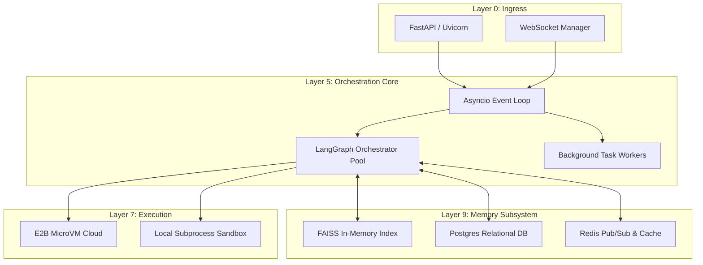

# Runtime Architecture Diagram

The Runtime Architecture of SELENE OS dictates how processes, threads, tasks, and resources are managed to ensure a highly concurrent, responsive, and robust cognitive operating system.

## 1. Process Architecture

SELENE OS is built around a single, highly optimized **FastAPI** web server running on Uvicorn. This primary process handles HTTP REST requests and long-lived WebSocket connections.

## 2. Thread and Task Model

Because the orchestrator relies heavily on network I/O (LLM API calls, database queries), SELENE utilizes Python's `asyncio` for concurrency rather than OS-level multi-threading or multiprocessing.

- **Event Loop**: The main Uvicorn event loop handles all incoming network traffic.
- **Async Tasks**: When a user submits a prompt, a new `asyncio.Task` is spawned for the LangGraph orchestrator. This task yields control to the event loop whenever it waits for an LLM response or execution result.
- **Thread Pools**: For CPU-bound operations (like computing BGE-2 reranking embeddings or querying the FAISS index), execution is offloaded to a `ThreadPoolExecutor` via `asyncio.to_thread()`, preventing the main event loop from blocking.

## 3. Resource Management

Efficient resource management is critical for performance:

- **LLM Connection Pooling**: The `LLMService` maintains persistent HTTP keep-alive connections to OpenAI/Anthropic APIs via `httpx.AsyncClient`, reducing TLS handshake overhead.
- **Vector Store**: The FAISS index is kept in RAM for ultra-fast dense retrieval. It is periodically flushed to disk/Postgres.
- **Memory Decay**: A scheduled background task runs every hour to apply the exponential decay function to memory scores: $S_{new} = S_{old} \times \exp(-\lambda \Delta t)$, where $\lambda = 0.01$.

## 4. Startup Sequence

When the `main.py` entry point is executed, the following startup sequence occurs:

1. **Environment Validation**: Load `.env` and `selene.toml`.
2. **Database Migrations**: Apply pending Postgres schema updates.
3. **Memory Hydration**: Load the FAISS index from persistent storage into RAM.
4. **Graph Compilation**: Compile the LangGraph state machine from `graph_routing.py`.
5. **Worker Initialization**: Start background workers (timeout monitors, memory decay).
6. **Server Ready**: Bind to port 8000 and expose `/health/ready`.

## 5. Shutdown Sequence

Graceful shutdown ensures no data loss or corrupted traces:

1. **Stop Accepting Traffic**: The FastAPI server rejects new requests with `503 Service Unavailable`.
2. **Drain Tasks**: The system waits up to 30 seconds for existing LangGraph orchestrators to finish their current node.
3. **Persist State**: The RAM-based FAISS index is saved to disk.
4. **Close Connections**: Redis, Postgres, and HTTP clients are safely closed.
5. **Process Exit**.
