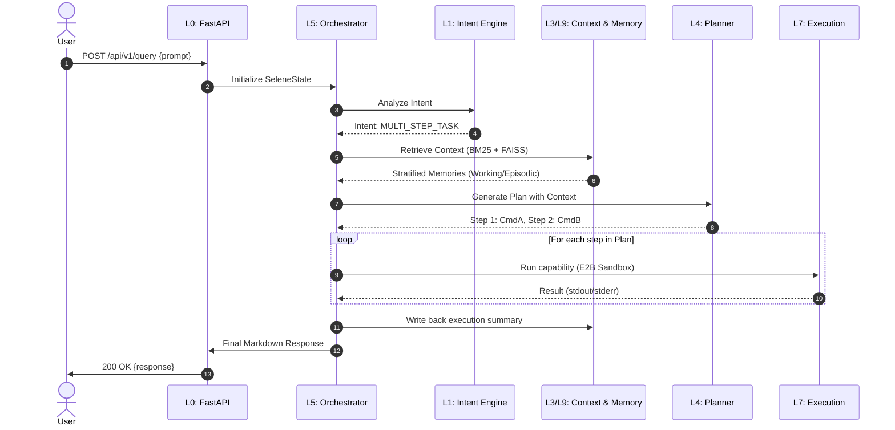
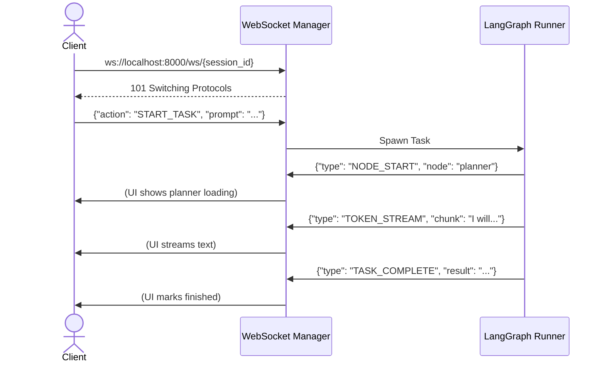
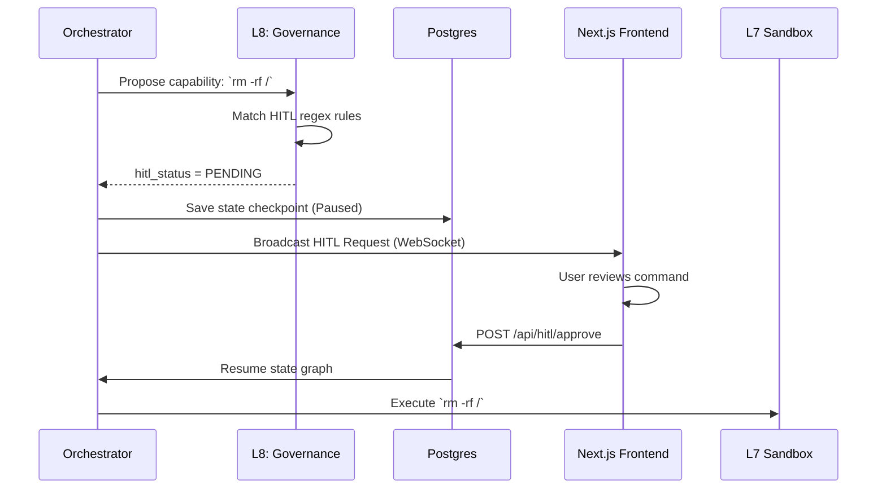
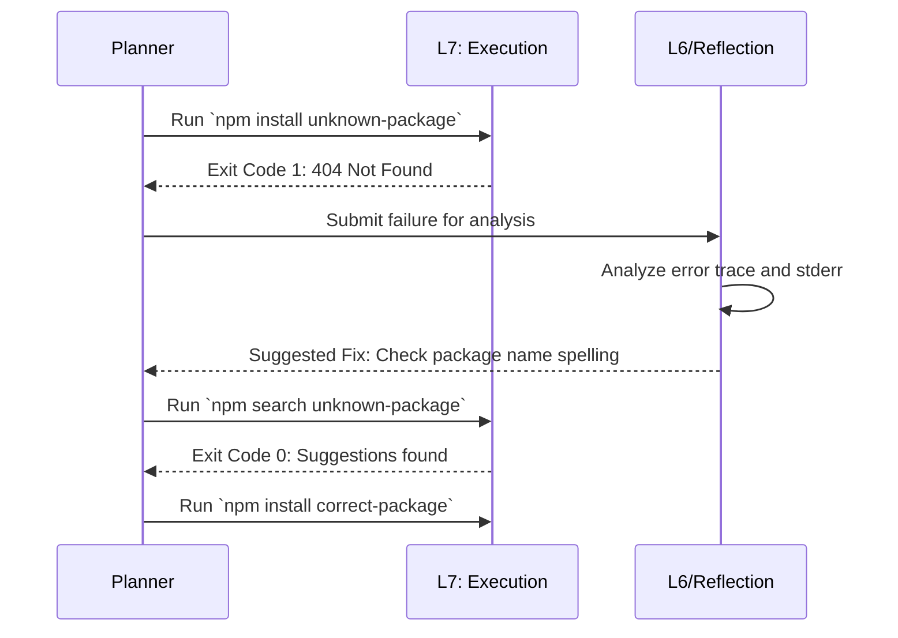
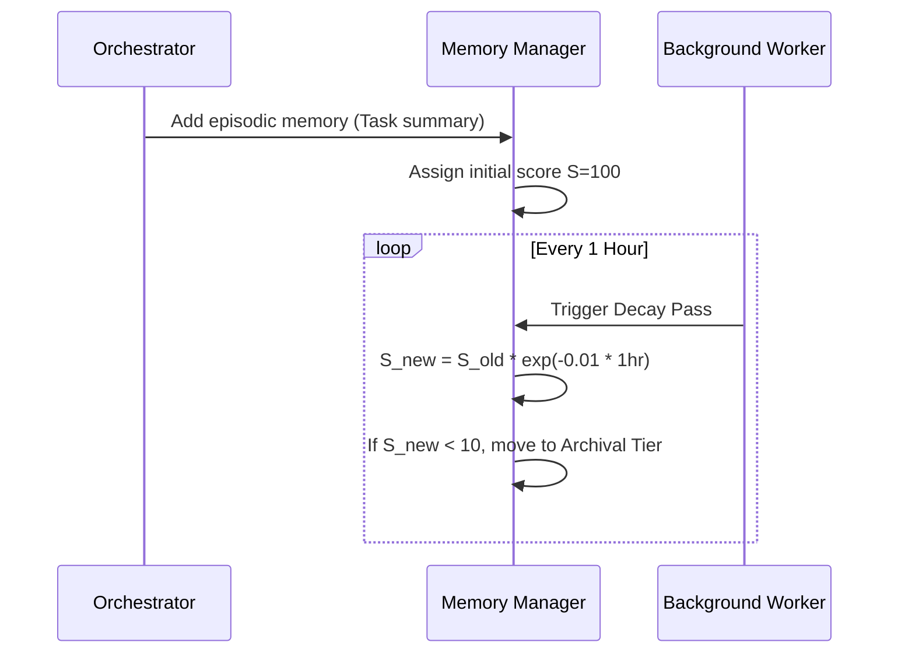

# End-to-End Sequence Diagrams

This document illustrates the precise sequencing of events across the 10 layers of SELENE OS for various standard operations. 

## 1. Full Query Processing Sequence

This is the standard "happy path" when a user submits a complex prompt requiring planning, context retrieval, and execution.

## 2. WebSocket Streaming Sequence

For real-time UI updates, SELENE relies on WebSockets rather than HTTP polling.

## 3. Human-in-the-Loop (HITL) Sequence

When a task violates safety thresholds (e.g., destructive commands).

## 4. Error Handling and Reflection Sequence

When an execution step fails, SELENE OS uses a self-correction loop.

## 5. Memory Write-Back & Decay Sequence

Memories in SELENE OS are not static; they decay over time unless reinforced.

