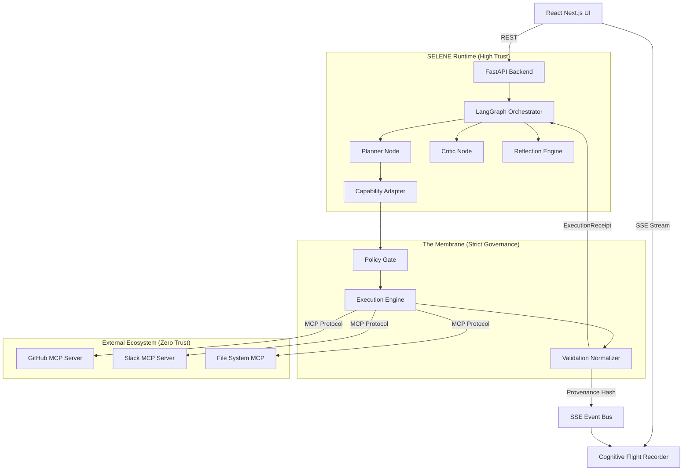

# 🗺️ System Topology

SELENE is distributed across specialized service boundaries to enforce cognitive separation.

## Technical Infrastructure Map

## SSE Flow
The backend uses Server-Sent Events (SSE) to push raw cognitive states (`cognitive_step`, `tamper_lock`) to the frontend. The React UI synthesizes this data into causal reconstruction for the human operator.
