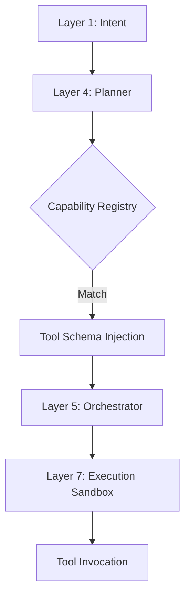

# Model Context Protocol (MCP) Governance

## 1. Introduction

The Model Context Protocol (MCP) in SELENE OS defines the standardized methodology by which cognitive agents interact with external tools, APIs, and data sources. Unlike traditional monolithic systems, SELENE's multi-agent architecture (10 Layers) relies on strict boundaries and verifiable capability mappings to ensure security, predictability, and auditability.

MCP Governance establishes the rule-set for tool registration, invocation routing, permission evaluation, and sandbox execution within Layer 7 (Execution Sandbox).

## 2. MCP in SELENE Context

In SELENE OS, an agent's capability is not inherent to the LLM model itself, but is dynamically injected via the Model Context Protocol. MCP standardizes:
- **Capability Advertisement**: How tools declare their schemas, requirements, and constraints.
- **Context Injection**: How tool context is provided to the LLM context window efficiently.
- **Invocation Formats**: Standardized JSON-RPC or similar structured output formats for tool use.
- **Data Handling**: How sensitive data retrieved by tools is scrubbed or encrypted before entering the LLM prompt.

### 2.1 Capability Routing (Layer 4 to Layer 7)

When Layer 1 (Intent Decomposer) identifies a user intent, Layer 4 (Planner) maps this intent to available capabilities.



## 3. Tool Registration and Capability Declaration

All tools must be registered via the `/api/v1/governance/mcp/register` endpoint. A valid tool registration includes:

- **Name**: Unique identifier (`[a-z_]+`).
- **Description**: Semantic description for Layer 4 matching.
- **Parameters**: JSON Schema of expected inputs.
- **Category**: (e.g., `filesystem`, `network`, `compute`).
- **Risk Level**: (0: Trivial, 1: Low, 2: Medium, 3: High, 4: Critical).

### Example Tool Registration Schema

```json
{
  "name": "read_url_content",
  "description": "Fetch content from a URL via HTTP GET request.",
  "parameters": {
    "type": "object",
    "properties": {
      "url": {
        "type": "string",
        "format": "uri"
      }
    },
    "required": ["url"]
  },
  "category": "network",
  "risk_level": 2
}
```

## 4. Permission Model

SELENE implements a strict Role-Based Access Control (RBAC) integrated with Human-in-the-Loop (HITL) locks (Layer 8).

| Risk Level | Description | Execution Policy | Example Tool |
|---|---|---|---|
| 0 (Trivial) | No side effects, purely computational. | Auto-approve | `calculator`, `format_date` |
| 1 (Low) | Read-only local data access. | Auto-approve | `read_file`, `list_dir` |
| 2 (Medium) | External read-only network access. | Rate-limited auto | `read_url_content` |
| 3 (High) | Local write operations. | HITL Confirmation required | `write_to_file`, `delete_file` |
| 4 (Critical) | Arbitrary code execution. | Strict HITL + E2B Sandbox | `run_python`, `exec_shell` |

### 4.1 Sandboxing Boundaries (Layer 7)

All tool invocations above Risk Level 2 are executed in isolated environments.
- **Primary**: E2B cloud microVMs (`backend/governance/plugin_sandbox.py`).
- **Fallback**: Local subprocess with restricted user permissions and `cgroups` limitation.

## 5. Audit Logging

Every MCP tool invocation is logged in the `mcp_audit_logs` Postgres table.
The log schema captures:
- `timestamp`: UTC invocation time.
- `trace_id`: Correlated with the LangGraph state trace.
- `tool_name`: Invoked tool.
- `inputs`: Scrubbed input parameters.
- `status`: Success, Failed, Blocked by HITL.
- `latency_ms`: Execution time.

## 6. Rate Limiting

Rate limits are enforced at Layer 0 (Ingress Router) and Layer 8 (Governance) via Redis sliding window counters.
- **Compute Tools**: 100 rpm
- **Network Tools**: 30 rpm
- **Execution Tools**: 10 rpm

$$ R_{allowed} = \max(0, L_{max} - \sum_{i=1}^{w} req_i ) $$
where $w$ is the sliding window size.

## 7. Compliance

To ensure compliance with the Operator Covenant, tools must never execute shell commands directly bypassing the sandbox, nor can they circumvent SSRF protections.
