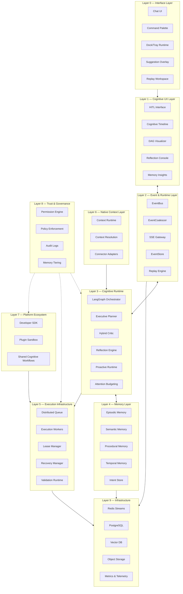

# 🌙 SELENE OS — Final Architectural Topology & Deployment Roadmap

This document serves as the canonical system blueprint, engineering reference, and deployment roadmap for the SELENE Cognitive Operating System. 

The true innovation of SELENE lies not in its individual automation tools, but in its **Cognitive Separation Architecture**. By strictly decoupling cognition, execution, reflection, validation, memory, and governance, SELENE achieves stability, explainability, and trust at scale.

---

## 🏛️ STEP 1: Final Architectural Topology Map

The system is organized into 10 strict boundaries. Lower layers provide infrastructure and governance, while upper layers handle ambient cognition and user interaction.

### Layer Definitions
*   **Layer 0-2 (Interface & Events)**: Surfaces the cognition respectfully via ambient overlays and structured SSE streams. Guarantees "Cognitive Calm."
*   **Layer 3 (Cognitive Runtime)**: The core intelligence. Generates constrained plans, critiques actions, reflects on failures, and proposes ambient actions within a strict Attention Budget.
*   **Layer 4 (Memory)**: Separates stable preferences (Procedural) from temporary goals (Intent Store) and workflow recurrence (Temporal).
*   **Layer 5 (Execution)**: Completely decoupled from orchestration. Distributed workers poll tasks with leases, ensuring resilience against crashes.
*   **Layer 6 (Native Context)**: Abstracts desktop telemetry into semantic signals with differential half-life decay. No raw surveillance.
*   **Layer 7-8 (Platform & Governance)**: Provides a strict sandbox for third-party extensions. Ensures memory isolation (Personal, Team, Org) and prevents plugins from mutating the core brain.

---

## 🚀 STEP 2: Real-World Deployment Roadmap

With the architecture complete, the focus shifts to **Operations**. We must protect the cognitive core while exposing the ecosystem incrementally.

### Stage 1: Internal Developer Alpha
*   **Scope**: Trusted users, limited plugins.
*   **Focus**: Validate the distributed queues, recovery managers, and event coalescing under real multi-session load. Prove that orchestrator state successfully checkpoints and recovers on crash.

### Stage 2: Connector Stabilization
*   **Scope**: Only the "Big 4" Connectors (VSCode, GitHub, Slack, Notion).
*   **Focus**: Stabilize the Native Context Layer. Ensure semantic resolution works correctly (e.g., stitching VSCode + GitHub into a single `feature_delivery_workflow`) without polluting the Intent Store with noisy false positives.

### Stage 3: Cognitive Workflow Packs
*   **Scope**: Shipping officially curated, reusable workflows.
*   **Focus**: Launch the "Deployment Workflow," "Research Workflow," and "Debugging Workflow." This proves the `SharedCognitiveWorkflow` schema works and provides immediate value before opening the doors to custom user-generated workflows.

### Stage 4: Team Collaboration
*   **Scope**: Multi-user environments.
*   **Focus**: Introduce Organizational Memory Partitions (Team/Org tiers). Test collaborative planning, shared replay traces, and multi-user approval chains. Ensure absolute data isolation between `Personal` and `Org` contexts.

### Stage 5: Controlled Ecosystem
*   **Scope**: Third-party developers.
*   **Focus**: Publish the `SeleneSDK` and the Plugin Sandbox. Open the verified Capability Marketplace. Enforce strict Trust Classifications and Policy Enforcement on all external submissions. 

---

## ⚠️ The Final Immutable Rule

**Protect the cognitive core.**

Connectors, plugins, and UI overlays are replaceable. The cognitive architecture (Planner, Critic, Reflection, Policy, Memory) must remain centralized, governed, and completely isolated from arbitrary third-party execution. 

This strict separation is what differentiates SELENE from chaotic autonomous agents and elevates it into a true, trusted Cognitive Operating System.
