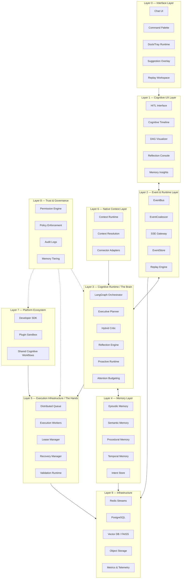
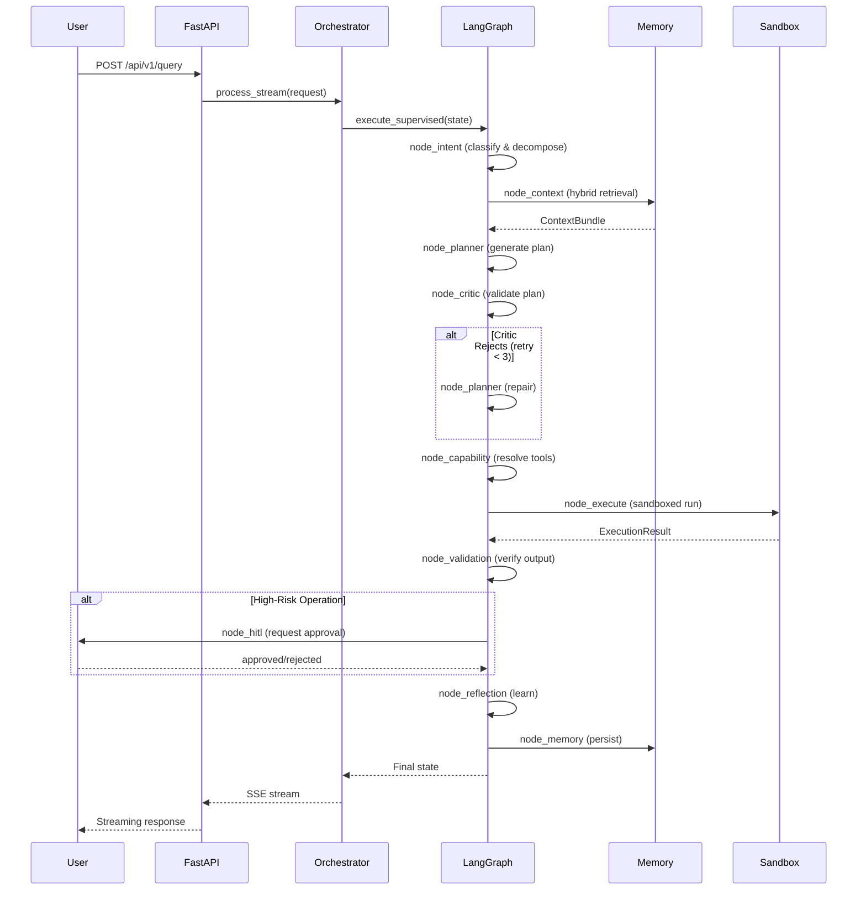

# SELENE OS — Final Architectural Topology & Deployment Roadmap

This document serves as the **canonical system blueprint**, engineering reference, and deployment roadmap for the SELENE Cognitive Operating System.

The true innovation of SELENE lies not in its individual automation tools, but in its **Cognitive Separation Architecture**. By strictly decoupling cognition, execution, reflection, validation, memory, and governance, SELENE achieves stability, explainability, and trust at scale.

---

## Table of Contents

1. [Architectural Topology Map](#step-1-final-architectural-topology-map)
2. [Layer Definitions](#layer-definitions)
3. [Data Flow Architecture](#data-flow-architecture)
4. [Implementation Status](#implementation-status)
5. [Technology Stack](#technology-stack)
6. [Deployment Roadmap](#step-2-real-world-deployment-roadmap)
7. [Immutable Rules](#the-final-immutable-rule)

---

## STEP 1: Final Architectural Topology Map

The system is organized into **10 strict boundaries**. Lower layers provide infrastructure and governance, while upper layers handle ambient cognition and user interaction. Each layer communicates only through well-defined interfaces — no layer may bypass its neighbors.



### Layer Definitions

#### Layer 0–2: Interface & Events
Surfaces the cognition respectfully via ambient overlays and structured SSE streams. Guarantees "Cognitive Calm" — the user is never overwhelmed by system activity. The frontend (Next.js) provides a chat interface, cognitive timeline, and DAG visualizer. Server-Sent Events stream cognitive steps from the backend in real-time.

**Key files**: `frontend/` (Next.js submodule)

#### Layer 3: Cognitive Runtime (The Brain)
The core intelligence. This is where SELENE *thinks*:

| Component | Implementation | Key File |
|-----------|---------------|----------|
| **LangGraph Orchestrator** | 10-node state machine with conditional routing, checkpointing, and repair loops | `backend/core/graph_routing.py` |
| **Executive Planner** | LLM-based multi-step plan generation with capability-tool matching | `backend/core/planner.py` |
| **Hybrid Critic** | 4-dimensional validation (Logical, Safety, Capability, Resource) with deterministic DAG & cognitive criterion verification | `backend/core/critic.py` |
| **Reflection Engine** | 3-tier reflection (operational → tactical → strategic) with learning policy evaluation | `backend/core/graph_nodes.py` |
| **Intent Engine** | LLM-based intent classification with multi-intent splitting | `backend/core/intent_engine.py` |
| **Mode Engine** | DEP personalization with Sparse Autoencoder filtering | `backend/core/mode_engine.py` |

The LangGraph state machine executes the following node sequence:

```
intent → context → planner → critic → capability → execute → validation → hitl → reflection → memory
```

With conditional edges for:
- **Plan repair loop**: If critic rejects, route back to planner (max 3 retries)
- **HITL suspension**: If high-risk operation, pause for human approval
- **Execution retry**: If validation fails, retry execution (max 3 attempts)

#### Layer 4: Memory
Five-tier stratified memory with exponential temporal decay:

| Tier | Retention | Purpose | Implementation |
|------|-----------|---------|----------------|
| **Working** | ≤ 1 hour | Active session state | `WorkingMemoryStore` |
| **Episodic** | ≤ 24 hours | Recent interaction traces | `EpisodicStore` |
| **Semantic** | ≤ 7 days | Factual knowledge with confidence scoring | `SemanticStore` |
| **Procedural** | ≤ 30 days | Learned skills and workflow patterns | `ProceduralStore` |
| **Archival** | > 30 days | Long-term institutional knowledge | Decay-weighted retrieval |

Temporal decay formula: `effective_score = raw_score × exp(-λ × Δt_hours)` where λ = 0.01

Hybrid retrieval pipeline:
1. **BM25 sparse search** — keyword matching with TF-IDF scoring
2. **FAISS dense search** — semantic similarity via embedding vectors (384 dimensions)
3. **RRF fusion** — Reciprocal Rank Fusion with α=0.7 (dense) and 0.3 (sparse)
4. **BGE-2 reranking** — Cross-encoder reranking via `BAAI/bge-reranker-base`

**Key files**: `backend/memory/vector_store.py`, `backend/memory/stores.py`, `backend/memory/retrieval.py`

#### Layer 5: Execution Infrastructure (The Hands)
Completely decoupled from orchestration. Workers execute deterministic task nodes through sandboxed environments:

- **E2B MicroVM**: Ephemeral cloud sandboxes via E2B API for code execution
- **Local Fallback**: Isolated subprocess with 30-second timeout when E2B is unavailable
- **Distributed Queue**: Redis Streams-based task distribution with lease management
- **Recovery Manager**: Automatic PEL (Pending Entries List) scanning for dead worker recovery

**Key files**: `backend/governance/plugin_sandbox.py`, `backend/workers/`

#### Layer 6: Native Context
Abstracts desktop and external telemetry into semantic signals with differential half-life decay. No raw surveillance — only semantic context abstraction.

**Supported connectors**: VSCode, GitHub, Slack, Notion (via `backend/connectors/`)

#### Layer 7–8: Platform & Governance
Provides a strict sandbox for third-party extensions with memory isolation:

| Boundary | Scope | Access Control |
|----------|-------|----------------|
| **Personal** | Individual user | User-scoped data only |
| **Team** | Team members | Shared within team boundary |
| **Organization** | All org users | Organization-wide policies |

Governance features:
- **HITL**: Human-in-the-Loop mutation locks for high-risk operations
- **SSRF Protection**: URL validation, blocked schemes, private IP detection
- **Shell Blocking**: Regex-based dangerous command detection and blocking
- **Trust Classifications**: VERIFIED_SAFE → VERIFIED → COMMUNITY → EXPERIMENTAL → BLOCKED

**Key files**: `backend/governance/`, `backend/safety/`, `backend/mcp/`

#### Layer 9: Infrastructure
The persistence and messaging backbone:

| Service | Technology | Purpose |
|---------|-----------|---------|
| **Database** | PostgreSQL 15 | Relational data, execution history, audit logs |
| **Cache/Queue** | Redis 7 | Pub/sub, task queues, session caching |
| **Vector Store** | FAISS (in-memory) | Semantic similarity search |
| **Metrics** | Prometheus-compatible | Health checks, performance telemetry |

---

## Data Flow Architecture

### Query Processing Flow



---

## Implementation Status

### Alpha v0.1.3 — Current Release

| Layer | Component | Status | Notes |
|-------|-----------|--------|-------|
| 0 | FastAPI Ingress | Implemented | REST + WebSocket endpoints |
| 0 | Health Checks | Implemented | /health/live, /health/ready, /health/metrics |
| 1 | Intent Engine | Implemented | LLM-based classification |
| 2 | DEP Personalization | Implemented | Cosine delta + SAE filter |
| 3 | Context Engine | Implemented | RRF 70/30 + BM25 + FAISS + BGE-2 |
| 4 | Planner | Implemented | Multi-step plan generation |
| 5 | LangGraph Orchestrator | Implemented | 10-node state machine |
| 6 | Critic Agent | Implemented | Deterministic DAG checks + Cognitive verification |
| 7 | Execution Sandbox | Implemented | E2B microVM + local fallback |
| 8 | Governance | Implemented | HITL, SSRF, shell blocking |
| 9 | Memory | Implemented | 5-layer stratification + decay |
| — | Docker | Implemented | docker-compose.yml |
| — | Structured Logging | Implemented | JSON + rotation |
| — | Frontend | In Progress | Next.js dashboard |

---

## Technology Stack

| Category | Technology | Version | Purpose |
|----------|-----------|---------|---------|
| **Runtime** | Python | 3.11+ | Backend language |
| **Web Framework** | FastAPI | Latest | Async REST + WebSocket |
| **AI Orchestration** | LangGraph | Latest | Cognitive state machine |
| **Vector Search** | FAISS | Latest | Dense similarity search |
| **Sparse Search** | BM25 (custom) | — | Keyword-based retrieval |
| **Reranking** | BAAI/bge-reranker-base | — | Cross-encoder reranking |
| **LLM Providers** | OpenAI, Anthropic | — | Multi-provider with fallback |
| **Database** | PostgreSQL | 15 | Persistent storage |
| **Cache/Queue** | Redis | 7 | Pub/sub, task queues |
| **Sandboxing** | E2B | Latest | Cloud microVM execution |
| **Frontend** | Next.js | 14+ | React-based dashboard |
| **Containerization** | Docker | — | Deployment packaging |
| **Hosting** | Render.com | — | Cloud deployment |

---

## STEP 2: Real-World Deployment Roadmap

With the architecture complete, the focus shifts to **Operations**. We must protect the cognitive core while exposing the ecosystem incrementally.

### Stage 1: Internal Developer Alpha (Current Stage)
- **Scope**: Trusted users, limited plugins
- **Focus**: Validate the distributed queues, recovery managers, and event coalescing under real multi-session load. Prove that orchestrator state successfully checkpoints and recovers on crash.
- **Deliverables**: Docker deployment, health monitoring, structured logging, regression test suite
- **Success Criteria**: 10+ sessions without cognitive state corruption

### Stage 2: Connector Stabilization
- **Scope**: Only the "Big 4" Connectors (VSCode, GitHub, Slack, Notion)
- **Focus**: Stabilize the Native Context Layer. Ensure semantic resolution works correctly (e.g., stitching VSCode + GitHub into a single `feature_delivery_workflow`) without polluting the Intent Store with noisy false positives.
- **Deliverables**: Stable connector APIs, context resolution tests, integration test suite
- **Success Criteria**: <1% false positive rate in context resolution

### Stage 3: Cognitive Workflow Packs
- **Scope**: Shipping officially curated, reusable workflows
- **Focus**: Launch the "Deployment Workflow," "Research Workflow," and "Debugging Workflow." This proves the `SharedCognitiveWorkflow` schema works and provides immediate value before opening the doors to custom user-generated workflows.
- **Deliverables**: 3 verified workflow packs, workflow validation framework
- **Success Criteria**: Workflow completion rate >90%

### Stage 4: Team Collaboration
- **Scope**: Multi-user environments
- **Focus**: Introduce Organizational Memory Partitions (Team/Org tiers). Test collaborative planning, shared replay traces, and multi-user approval chains. Ensure absolute data isolation between `Personal` and `Org` contexts.
- **Deliverables**: Multi-tenant memory isolation, RBAC, team workflows
- **Success Criteria**: Zero cross-tenant data leakage in penetration testing

### Stage 5: Controlled Ecosystem
- **Scope**: Third-party developers
- **Focus**: Publish the `SeleneSDK` and the Plugin Sandbox. Open the verified Capability Marketplace. Enforce strict Trust Classifications and Policy Enforcement on all external submissions.
- **Deliverables**: Public SDK, developer portal, capability marketplace, trust certification process
- **Success Criteria**: 10+ third-party plugins deployed with zero trust incidents

---

## The Final Immutable Rule

**Protect the cognitive core.**

Connectors, plugins, and UI overlays are replaceable. The cognitive architecture — Planner, Critic, Reflection, Policy, Memory — must remain centralized, governed, and completely isolated from arbitrary third-party execution.

This strict separation is what differentiates SELENE from chaotic autonomous agents and elevates it into a true, trusted Cognitive Operating System.

---

## Related Documentation

| Document | Description |
|----------|-------------|
| [SELENE Manifesto](selene_manifesto.md) | Foundational principles and philosophy |
| [Architecture Overview](docs/architecture/ARCHITECTURE_OVERVIEW.md) | Detailed 10-layer architecture documentation |
| [Cognitive Runtime](docs/architecture/COGNITIVE_RUNTIME.md) | LangGraph state machine deep dive |
| [Memory Architecture](docs/architecture/MEMORY_ARCHITECTURE.md) | 5-tier memory system documentation |
| [Deployment Guide](docs/operations/DEPLOYMENT_GUIDE.md) | Setup and deployment instructions |
| [SDK Guide](docs/sdk/SDK_GUIDE.md) | API reference and integration guide |
| [Known Limitations](docs/operations/KNOWN_LIMITATIONS.md) | Alpha limitations and workarounds |
